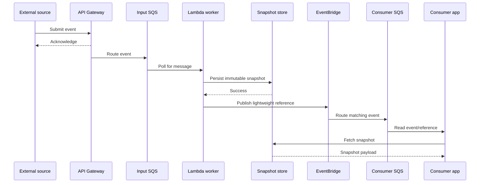
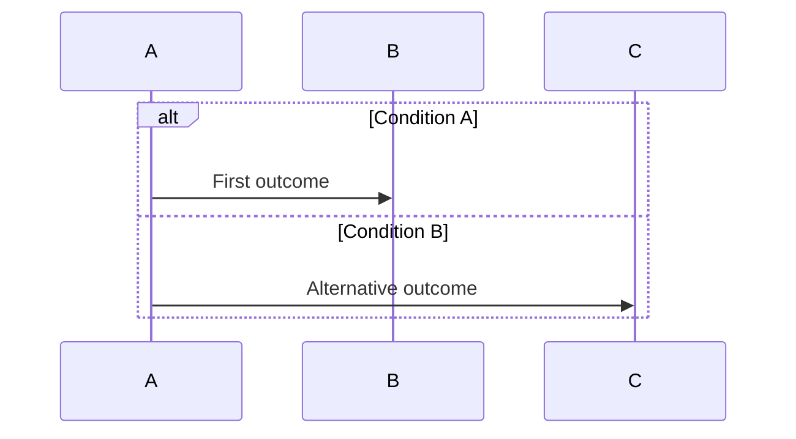
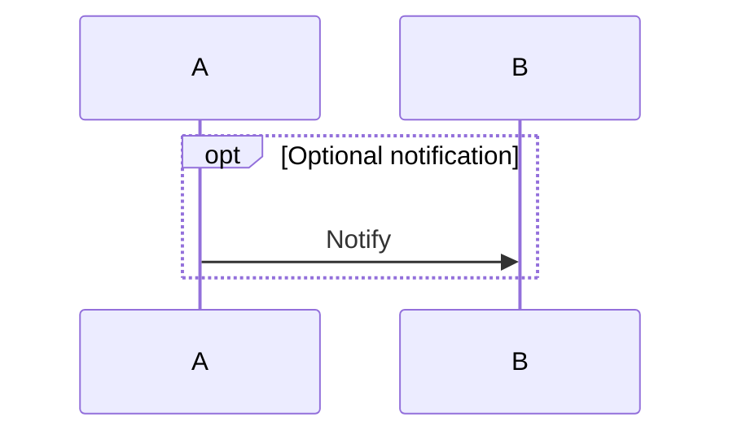
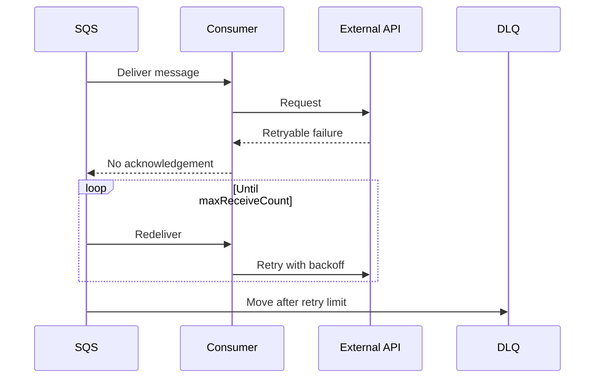
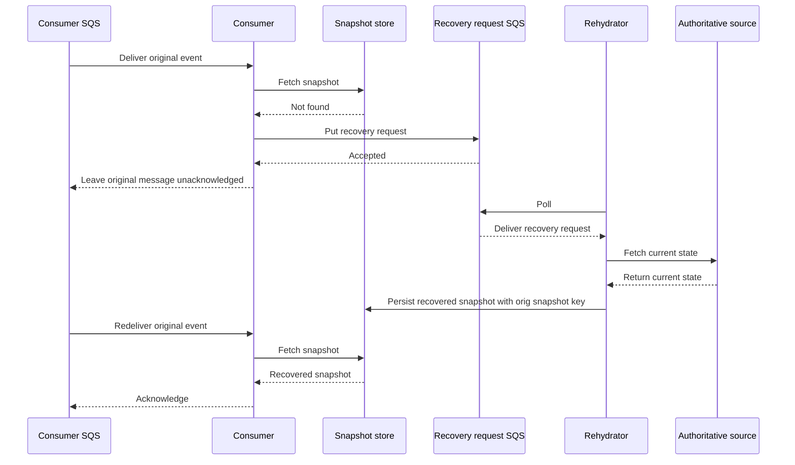
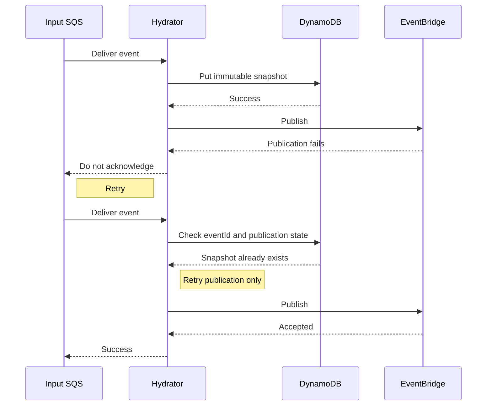
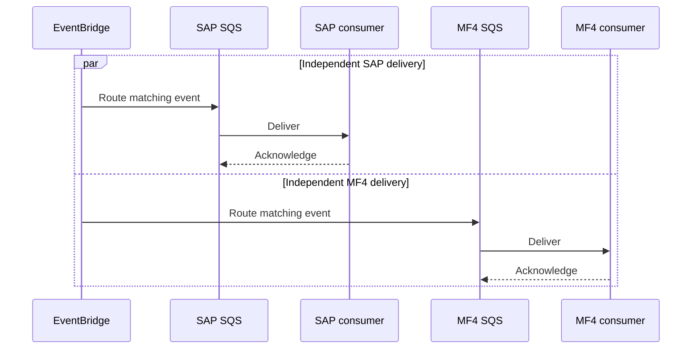

# Mermaid Patterns for AWS Architecture

Use Mermaid for behavior and timing. Keep infrastructure topology in draw.io unless the user requests a Mermaid infrastructure view.

## Happy path

## Conditional outcomes

`alt` is equivalent to `if / else` and does not represent a component.

Use `opt` when there is only one optional path:

## Bounded retry

Never use this pattern for a definitive condition that cannot change without a separate recovery action.

## Snapshot expired by TTL with centralized recovery

Include these qualifications:

* the recovery queue owns retry and a DLQ;
* duplicate recovery requests are idempotent;
* the original message is left unacknowledged only after the recovery request is durably accepted;
* visibility timeout and backoff allow recovery to complete;
* data fetched later is current state, not a historical reconstruction;
* consumers requiring historical state use controlled manual treatment;
* if recovery exceeds `maxReceiveCount`, redrive occurs only after recovery completes.

## Write succeeded, publication failed

Mark outbox or streams as a decision unless already approved.

## Consumer isolation

Use `par` only when paths are genuinely independent.

## Diagram quality

* Use descriptive participant aliases.
* Keep messages concise and directional.
* Avoid semicolons in sequence message text because some Mermaid versions parse them as statement separators.
* Use notes for assumptions and warnings, not additional pseudo-components.
* Avoid excessive nested `alt` and `loop` blocks; split the scenario when necessary.
* Validate every block with the target Mermaid version.